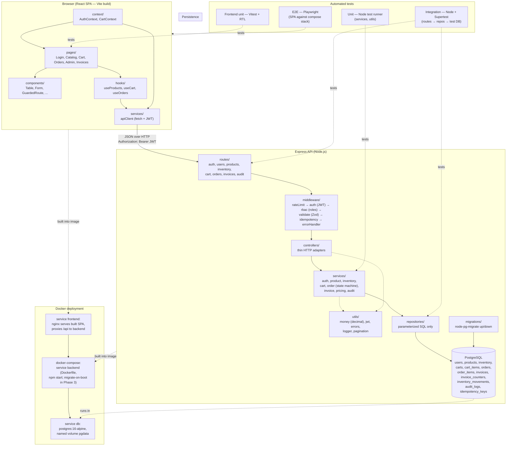

# Architecture — B2B Order Management Platform

**Document version:** 1.0 (Phase 1 — Planning & Design)
**Status:** Proposed design — not yet implemented.
**Related:** `requirements.md` (constraints C-01…C-10), `database-design.md`, `api-specification.md`, `decision-log.md`

---

## 1. Overview

The platform is a two-tier web application (React SPA + Express JSON API) backed by PostgreSQL, deployed with Docker Compose. The backend follows a strict **layered architecture** so that each concern lives in exactly one place:

```
HTTP → routes → middleware → controllers → services → repositories → PostgreSQL
```

- **Routes** map URL + method to a middleware chain and controller function. No logic.
- **Middleware** (cross-cutting): authentication (JWT verify), RBAC (role check), Zod validation, error handling, request logging, idempotency capture.
- **Controllers** translate HTTP ↔ domain: parse validated request, call one service, map result/exception to a status code + JSON body. No SQL, no business rules.
- **Services** hold business rules: pricing/totals math, stock reservation, state-machine transitions, invoice numbering, audit writes. They orchestrate repositories inside transactions. No `req`/`res` objects.
- **Repositories** are the only layer that writes SQL — always parameterized — and map rows ↔ plain objects. One module per table group.
- **Utils** are pure helpers (decimal money, JWT sign/verify, errors, pagination).

The frontend follows: **pages** (route-level composition) → **components** (presentational) → **context** (auth/cart state) → **hooks** (data operations) → **services** (fetch wrapper that attaches the JWT and normalizes API errors). The frontend never computes authoritative totals; it displays server values.

## 2. Architecture Diagram



## 3. Request lifecycle (worked example: order creation)

1. `POST /api/orders` with `Authorization: Bearer <jwt>` and `Idempotency-Key: <uuid>`.
2. **rateLimit** middleware → **auth** verifies JWT and loads the user (rejects disabled users) → **rbac('customer')** → **validate** runs the Zod schema → **idempotency** middleware looks the key up in `idempotency_keys`.
3. If a completed record exists for (user, key): short-circuit with the stored response (AC-ORD-04). Otherwise reserve the key `IN_PROGRESS`; a concurrent duplicate waits/fails fast with `409 DUPLICATE_REQUEST`.
4. **OrderController.createOrder** → **OrderService.createOrder(client)**:
   - `BEGIN` transaction.
   - Read cart + lines via `CartRepository`; lock inventory rows via `InventoryRepository.lockForProduct()` (`SELECT … FOR UPDATE`).
   - **PricingService** recomputes line totals/tax/grand totals with decimal money utils (client values ignored).
   - If any line insufficient → throw `DomainError('INSUFFICIENT_STOCK')` → `ROLLBACK`.
   - Insert `orders` + `order_items` (name/price snapshots), increment `inventory.reserved_quantity` (available is the generated `physical − reserved`), insert `inventory_movements` (`type='order_reservation'`), insert audit row, empty cart.
   - `COMMIT`; store idempotency record with the response body.
5. Controller maps the result to `201` JSON; `errorHandler` maps any thrown `DomainError` to its HTTP code per `api-specification.md`.

## 4. Component responsibilities & file layout

> **As-built note (Phase 2):** the implemented scaffold uses top-level `frontend/` and
> `backend/` (instead of the earlier `client/`/`server/` naming) plus `database/seeds/` and
> an `evidence/` directory for test-report artifacts — see `decision-log.md` D-15. Later
> phases add `src/validations/`, per-layer test subfolders, and `e2e/` as features land.

```
b2b-order-platform/
├── frontend/                   # React + Vite SPA
│   ├── src/
│   │   ├── pages/ components/ context/ hooks/ services/   # (App.jsx uses components/hooks/services)
│   │   ├── App.jsx  main.jsx  styles.css
│   │   └── test/               # Vitest + RTL setup and unit tests
│   ├── index.html  vite.config.js  nginx.conf
│   ├── Dockerfile              # multi-stage: vite build -> nginx serve
│   └── .env.example
├── backend/                    # Express API (CommonJS)
│   ├── src/
│   │   ├── routes/ middleware/ controllers/ services/ repositories/
│   │   ├── utils/ (logger, errors)  config/ (env)  app.js  server.js
│   │   └── validations/        # added in Phase 3 (Zod schemas)
│   ├── migrations/             # node-pg-migrate scripts (empty in Phase 2)
│   ├── tests/                  # Node test runner (*.test.js) + Supertest
│   ├── Dockerfile  .env.example  eslint.config.js
├── database/
│   └── seeds/                  # demo data (flag-controlled)
├── e2e/                        # Playwright specs + config (Phase 5)
├── docs/                       # this documentation set
├── evidence/
│   ├── screenshots/
│   └── test-reports/           # saved lint/build/test output as evidence
├── docker-compose.yml          # db + backend + frontend
├── .env.example  .gitignore  .prettierrc.json  .editorconfig
├── package.json                # root orchestration scripts
└── README.md
```

| Component | Owns | Must not |
|---|---|---|
| routes | URL surface, middleware ordering | business logic, SQL |
| middleware | authn/authz, validation, idempotency, errors, logging | DB writes (except idempotency via service) |
| controllers | HTTP mapping, status codes | business rules, SQL |
| services | business rules, transactions, state machine, audit | `req`/`res`, raw SQL strings |
| repositories | parameterized SQL, row mapping | business decisions, HTTP |
| frontend services/ | fetch, token attach, error normalize | price/total computation as source of truth |
| migrations | schema evolution, constraints | data fixes without a movement/audit path |

## 5. Cross-cutting design decisions (summary — full rationale in `decision-log.md`)

- **JWT bearer tokens**, short-lived (2 h), verified per request with a user-status re-check so deactivation takes effect immediately (FR-AUTH-06). No refresh-token rotation in v1.
- **RBAC as data**: single `role` column (`admin|agent|customer`) checked by `authorize(...roles)` middleware; permissions table deferred (D-05).
- **Reservation model** (as-built, Phase 3 — D-18): ordering increments `inventory.reserved_quantity` under row lock after validating generated `available_quantity = physical − reserved ≥ qty`; cancellation releases the reservation; fulfillment consumes `physical` and `reserved` together. CHECK constraints make an illegal stock state uncommittable (D-06).
- **Snapshots everywhere history matters**: `order_items` store name/price/tax at order time; invoices are generated from those snapshots (D-07).
- **Idempotency persisted**: `idempotency_keys` table keyed `(user_id, key)` storing response; scoped to order creation (D-08).
- **Money**: `NUMERIC(12,2)` in DB (D-17); integer-cent arithmetic in JS utils; half-up rounding per line then sum (D-09, NFR-07).
- **Errors**: one `DomainError` taxonomy → stable machine codes in API responses (see `api-specification.md` §3).
- **Health**: `GET /api/health` runs `SELECT 1` against the pool and reports `db: up|down|not_configured` — 503 `degraded` when the DB is configured but unreachable (FR-AUD-04).

## 6. Security architecture

- Boundary: all untrusted input validated by Zod at the route; unknown fields stripped (`z.strictObject`).
- AuthN: `authenticate` middleware (HMAC-signed JWT, secret from env only). AuthZ: `authorize` per route; resource-ownership filters re-applied inside services (customers can only ever address their own cart/order/invoice rows; other customers' resources resolve to `404`).
- SQL: parameterized only (C-04); least-privilege DB user for the app role in compose.
- Headers: `helmet`, explicit CORS allow-list of the client origin, body size limit (100 KB).
- Abuse: `express-rate-limit` on `/api/auth/login` (10/min/IP) and global 300 req/min.
- Secrets: env-only (NFR-03); `.env` gitignored; `.env.example` documents every variable name without values.
- Logging: request logger records method, path, status, duration, user ID — never bodies for auth routes; audit service whitelists fields written to `audit_logs` (FR-AUD-05).

## 7. Deployment topology (Docker)

- **Compose services (as-built Phase 2):** `db` (postgres:16-alpine, named volume `pgdata`, healthcheck `pg_isready`), `backend` (build from `backend/Dockerfile`, `depends_on: db healthy`, env from process env set in compose), and `frontend` (nginx serving the Vite build, `depends_on: backend`, proxies `/api` to `backend:4000` so the SPA is same-origin). Local dev mode instead runs `npm run dev` on host (Vite proxies `/api` to the backend).
- **Migrations on boot** (planned Phase 3, once the schema exists) make `docker compose up --build` a one-command start (NFR-12); the named volume satisfies NFR-14 data preservation. In Phase 2 `backend/migrations/` is intentionally empty (no business schema yet).
- **Test topology:** integration tests run against a separate schema/database (`npm run test:integration` requires `DATABASE_URL_TEST`); Playwright runs against the compose stack.

## 8. Scalability & evolution notes (not v1 commitments)

- Stateless API allows horizontal scaling behind a load balancer once sessions are purely JWT-based (done) and idempotency/lock contention are measured.
- Read/write split, a reservation *ledger* instead of a single `available_quantity` column, and outbox-pattern invoice PDF generation are the identified next steps if scale exceeds A-07 assumptions.
