# Database Design — B2B Order Management Platform

**Document version:** 1.2 (Phase 5 as-built — `inventory.low_stock_threshold` added by migration 14; see D-20)
**Engine:** PostgreSQL 16 · **Migrations:** `node-pg-migrate` (up/down scripts in `backend/migrations/`, as-built D-15)
**Related:** `requirements.md` (FR/NFR), `architecture.md` §5, `api-specification.md`

Conventions: BIGSERIAL integer primary keys (Phase 3 switch from UUID — see D-17), `TIMESTAMPTZ` timestamps defaulting to `now()`, `NUMERIC(12,2)` for all money, snake_case names, `CHECK` constraints for enums-in-columns, soft delete only where history demands it (`users.is_active`, `products.is_active`).

---

## 1. ER Diagram

```mermaid
erDiagram
    users ||--o| carts : "has (customer only)"
    users ||--o{ orders : "places (customer)"
    users ||--o{ inventory_movements : "performs (admin/agent)"
    users ||--o{ audit_logs : "acts (actor)"
    users ||--o{ idempotency_keys : "owns"

    products ||--|| inventory : "stocked-as 1:1"
    products ||--o{ cart_items : "listed-in"
    products ||--o{ order_items : "snapshotted-in"
    products ||--o{ inventory_movements : "moved-as"

    carts ||--|{ cart_items : "contains"
    orders ||--|{ order_items : "contains"
    orders ||--o| invoices : "billed-as (1:0..1, minted at shipment)"
    orders ||--o{ audit_logs : "tracked-as"

    users {
        bigint id PK
        varchar email UK "unique, citext-normalized lowercase"
        varchar password_hash "bcrypt, never returned"
        varchar name
        varchar role "CHECK: admin | agent | customer"
        boolean is_active "soft disable (FR-AUTH-06)"
        timestamptz created_at
        timestamptz updated_at
    }
    products {
        bigint id PK
        varchar sku UK "unique product code (FR-CAT-03)"
        varchar name
        text description
        numeric unit_price "CHECK > 0, NUMERIC(12,2)"
        numeric tax_rate "CHECK 0..100, percent"
        boolean is_active "soft delete (FR-CAT-02/08)"
        timestamptz created_at
        timestamptz updated_at
    }
    inventory {
        bigint product_id PK "FK -> products, 1:1"
        integer physical_quantity "CHECK >= 0; units on hand"
        integer reserved_quantity "CHECK >= 0; claimed by live orders"
        integer available_quantity "GENERATED (physical - reserved); overselling guard CHECK >= 0"
        integer low_stock_threshold "CHECK >= 0; NOT NULL DEFAULT 20 (Phase 5, D-20)"
        timestamptz updated_at
    }
    carts {
        bigint id PK
        bigint customer_id FK "UNIQUE -> users.id; one active cart per customer"
        timestamptz created_at
        timestamptz updated_at
    }
    cart_items {
        bigint id PK
        bigint cart_id FK
        bigint product_id FK
        integer quantity "CHECK >= 1"
        timestamptz created_at
    }
    orders {
        bigint id PK
        bigint customer_id FK "-> users.id"
        varchar status "CHECK: pending|confirmed|fulfilled|cancelled"
        varchar cancellation_reason "required iff status=cancelled"
        numeric subtotal "CHECK >= 0"
        numeric tax_total "CHECK >= 0"
        numeric grand_total "CHECK >= 0"
        timestamptz created_at
        timestamptz updated_at
    }
    order_items {
        bigint id PK
        bigint order_id FK
        bigint product_id FK "reference kept, but display uses snapshots"
        varchar product_name "historical snapshot (FR-ORD-04)"
        numeric unit_price "historical snapshot"
        numeric tax_rate "snapshot at order time"
        integer quantity "CHECK >= 1"
        numeric line_total "unit_price*quantity"
        numeric line_tax "round(line_total*tax_rate)"
    }
    invoices {
        bigint id PK
        bigint order_id FK "UNIQUE -> orders.id (one invoice per order, FR-INV-05)"
        varchar invoice_number UK "INV-YYYY-NNNNNN, unique"
        bigint issued_by FK "-> users.id (agent/admin)"
        date issued_date
        numeric subtotal "denormalized = orders.subtotal"
        numeric tax_total
        numeric grand_total "must equal orders.grand_total (AC-INV-01)"
        varchar status "CHECK: issued|voided; DEFAULT issued (migration 17)"
        varchar void_reason "set only when voided"
        timestamptz voided_at "set only when voided"
        timestamptz created_at
    }
    inventory_movements {
        bigint id PK
        bigint product_id FK
        bigint performed_by FK "-> users.id"
        integer quantity_delta "signed; CHECK != 0"
        varchar movement_type "CHECK: manual_adjust|order_reservation|order_cancellation"
        bigint order_id FK "NULL unless movement stems from an order"
        varchar reason
        timestamptz created_at
    }
    audit_logs {
        bigint id PK
        bigint actor_id FK "-> users.id, NULL for anonymous login failures"
        varchar actor_role
        varchar action "ORDER_CREATED, LOGIN_FAILED, ..."
        varchar entity_type "user|product|inventory|cart|order|invoice"
        bigint entity_id
        jsonb details "whitelisted fields only (FR-AUD-05)"
        varchar outcome "success|failure (migration 18)"
        timestamptz created_at
    }
    idempotency_keys {
        bigint id PK
        bigint user_id FK
        varchar idempotency_key UK "(user_id, idempotency_key) unique"
        varchar request_scope "endpoint, e.g. POST /api/orders"
        varchar status "CHECK: in_progress|completed|failed"
        smallint response_status "stored HTTP code for replays"
        jsonb response_body "stored payload for replays"
        timestamptz created_at
        timestamptz expires_at "24h retention (D-08)"
    }
    invoice_counters {
        varchar period PK "'YYYY' (yearly, the app key) or 'YYYY-MM'; CHECK broadened (migration 17)"
        integer next_val "CHECK >= 1; upsert-RETURNING numbering (D-10)"
    }
```

## 2. Table-by-table rationale

### 2.1 `users`
- **PK** `id` (BIGSERIAL). **Unique** `email` — enforced by `UNIQUE` index and enforced pre-check in service to return `409 DUPLICATE_EMAIL` rather than a raw 23505 (AC-AUTH-05). Email is CHECKed lowercase so uniqueness is case-insensitive without `citext`.
- `role` uses a `CHECK` constraint (three values); an ENUM type was rejected for migration flexibility (see decision log D-02).
- `is_active` supports immediate token revocation: the auth middleware re-loads the user per request (FR-AUTH-06).

### 2.2 `products`
- **PK** `id`; **Unique** `sku`. `unit_price CHECK (unit_price > 0)`, `tax_rate CHECK (tax_rate BETWEEN 0 AND 100)` — DB is the last line of defense behind Zod.
- Soft delete via `is_active` so `order_items.product_id` and `inventory.product_id` FKs never dangle (FR-CAT-02).

### 2.3 `inventory`
- Separate 1:1 table (PK `product_id` doubles as FK) so hot row locks (`SELECT … FOR UPDATE` during ordering) never contend with cold catalog columns (NFR-05).
- **Stock definitions (D-18):** `physical_quantity` = units on hand; `reserved_quantity` = units claimed by live orders (pending/confirmed); `available_quantity` = **stored generated column** (`physical − reserved`) — the sellable quantity, not directly writable (integration-tested: PostgreSQL rejects writes, SQLSTATE 428C9).
- **Overselling guard at DB level**: `CHECK (physical_quantity >= 0)`, `CHECK (reserved_quantity >= 0)`, `CHECK (physical_quantity - reserved_quantity >= 0)` — even a buggy service cannot commit an illegal stock state (risk R-01 mitigation).
- Lifecycle: order creation `reserved += qty` (requires `available >= qty`); cancellation `reserved -= qty`; fulfillment `physical -= qty` **and** `reserved -= qty`; receipts/corrections change `physical` only. Every step writes an `inventory_movements` ledger row in the same transaction.
- **Low-stock threshold (Phase 5, migration 14, D-20):** `low_stock_threshold integer NOT NULL DEFAULT 20 CHECK (low_stock_threshold >= 0)` — a per-product replenishment floor (cadence differs by SKU, so it is not a global constant). A product is **low-stock** iff `available_quantity <= low_stock_threshold`; `GET /api/inventory/low-stock` and the `is_low_stock` flag in the inventory row are both defined by exactly that comparison, so the rule lives in the schema rather than being re-derived per caller. Reversible: the migration drops only the constraint + column.

### 2.4 `carts` / `cart_items`
- `carts.customer_id` is **UNIQUE** → "exactly one active cart per customer" (FR-CART-01) is a DB guarantee, not application politeness.
- `cart_items` has **UNIQUE (cart_id, product_id)** → "add same product again" must be an UPDATE of quantity, never a second row (AC-CART-01). `quantity CHECK (quantity >= 1)`.
- No price stored in cart items: cart totals are always computed from live product prices at read time (cart is transient; orders are the record).

### 2.5 `orders`
- **PK** `id`; FK `customer_id → users.id`. `status CHECK IN ('pending','confirmed','fulfilled','cancelled')` mirrors the state machine (FR-ORD-07); transition legality is enforced in `OrderService` (DB cannot express sequences).
- Totals stored (`subtotal`, `tax_total`, `grand_total`) at creation and never recomputed — invoices and disputes read these numbers.
- Index `(customer_id, created_at DESC)` for "my orders"; index `(status)` for staff queues.

### 2.6 `order_items`
- **PK** `id`; FKs `order_id → orders` (`ON DELETE CASCADE` — items are meaningless without their order) and `product_id → products` (`ON DELETE RESTRICT`, though products are soft-deleted anyway).
- Carries the **historical snapshot**: `product_name`, `unit_price`, `tax_rate`, `quantity`, `line_total`, `line_tax` (FR-ORD-04, AC-ORD-06). Later catalog edits touch only `products`, never these rows.

### 2.7 `invoices`
- **PK** `id`; **UNIQUE** `order_id` → at most one invoice per order even under races/bugs (FR-INV-05, AC-INV-03); **UNIQUE** `invoice_number` → numbering collisions impossible.
- Totals denormalized from the order at generation time; AC-INV-01's test asserts they equal order totals and `subtotal + tax_total = grand_total` (also a DB CHECK, `invoice_totals_consistent`). Money is **never recomputed** from the live catalog, so a later price/name edit cannot alter an issued invoice (D-07 / SC-04).
- **Lifecycle (migration 17, D-25):** `status` is `issued | voided` (`DEFAULT 'issued'`, CHECK `invoice_status_valid`). The invoice is minted `issued` **inside the `→ shipped` transaction** (the fulfillment/stock-consumption point), so it cannot exist for an unshipped order and never twice for a shipped one. `voided` is a staff-only annulment that **preserves the row and its totals** (financial immutability) and stamps `void_reason` + `voided_at`; there is deliberately **no `paid`/`overdue`** state (settlement is out of scope, requirements §3.2). Because an order can only be cancelled pre-shipment, a cancelled order has **no invoice**.

### 2.8 `inventory_movements`
- Full ledger of every stock change with actor, signed delta, type, optional order link, and reason (FR-CAT-06). Makes `inventory.available_quantity` reconcilable: `SUM(quantity_delta)` per product should equal current stock — a property the integration suite asserts (catches lost/duplicated reservations).

### 2.9 `audit_logs`
- **PK** `id`; **append-only at the database level** — a `BEFORE UPDATE/DELETE` trigger (migration 11) raises an exception on any mutation, so history cannot be modified or deleted by anyone (including admins) through the API (FR-AUD-02). `actor_id` is nullable so a **failed login from an unknown account** can still be recorded (FR-AUD-01). `details JSONB` carries small whitelisted keys written only by `AuditService` — never a password, JWT, auth header or unnecessary PII (FR-AUD-05).
- **`outcome` (Phase 9, migration 18)** — `varchar NOT NULL DEFAULT 'success'` with a CHECK to `('success','failure')`. Rows are written **inside the same transaction** as the business change, so a rolled-back write leaves no row and every committed business row is `success`; `failure` is used only for security-relevant attempts that carry no data change (a rejected/disabled login). The default keeps all pre-Phase-9 rows valid without a backfill.
- Indexes: `(entity_type, entity_id, created_at)` for order-history lookups; `(actor_id, created_at)` for admin queries; and a plain `created_at` index (migration 18) backing the dashboard "recent activity" feed and the ADMIN date-range filters, which sort/scan on `created_at` alone (FR-AUD-03).

### 2.10 `idempotency_keys`
- **PK** `id`; **UNIQUE** `(user_id, idempotency_key)` — the insertion itself is the atomic "claim" of a key; two racing requests cannot both claim it (AC-ORD-04).
- `status in_progress` prevents a second request from starting work while the first is unfinished; `completed` rows store the exact response to replay. Rows are candidates for cleanup after `expires_at` (24 h, D-08/OQ-03).

### 2.11 `invoice_counters` (internal mechanism)
- **PK** `period`; the app keys it by **calendar year** (`'YYYY'`) so the 6-digit part increases strictly within a year — which is what keeps `UNIQUE(invoice_number)` guaranteed for a `INV-YYYY-NNNNNN` number. `next_val` is incremented atomically via `INSERT … ON CONFLICT (period) DO UPDATE SET next_val = invoice_counters.next_val + 1 RETURNING next_val` inside the shipping transaction → race-safe, gap-tolerant sequential invoice numbers (FR-INV-02, D-10). Migration 17 **broadens** the period CHECK from `^[0-9]{4}-[0-9]{2}$` to `^[0-9]{4}(-[0-9]{2})?$` so both the yearly app key and the pre-existing monthly fixtures are valid. Not a business entity; omitted from stakeholder-facing diagrams.

## 3. Relationship summary

| Relationship | Cardinality | Enforced by | Notes |
|---|---|---|---|
| user (customer) → cart | 1 : 0..1 | `UNIQUE(carts.customer_id)` | Created lazily on first add-to-cart |
| cart → cart_items | 1 : N | FK + `UNIQUE(cart_id, product_id)` | Upsert semantics |
| product → cart_item | 1 : N | FK | Deactivated products rejected in service |
| user (customer) → orders | 1 : N | FK | Ownership filter in every query (FR-ORD-11) |
| order → order_items | 1 : N | FK, cascade | Snapshot rows |
| order → invoice | 1 : 0..1 | FK + `UNIQUE(order_id)` | Appears only after `fulfilled` |
| product → inventory | 1 : 1 | PK-as-FK | Row-locked during ordering |
| product → inventory_movements | 1 : N | FK | Ledger |
| order → inventory_movements | 1 : N (0..2) | Nullable FK | Reservation on create; release on cancel |
| user → audit_logs | 1 : N | FK (nullable) | Actor, or NULL for anonymous failures |
| user → idempotency_keys | 1 : N | FK + `UNIQUE(user_id, key)` | Scope of replay protection |

## 4. Keys, constraints, and index inventory (migration checklist)

Migrations must create, at minimum:

1. No extensions required — BIGSERIAL primary keys replaced the UUID/`pgcrypto` design in Phase 3 (D-17).
2. Tables in dependency order: `users`, `products`, `inventory`, `carts`, `cart_items`, `orders`, `order_items`, `invoices`, `invoice_counters`, `inventory_movements`, `audit_logs`, `idempotency_keys`.
3. All `CHECK` constraints named for readable errors (`inventory_available_non_negative`, `order_status_valid`, `product_price_positive`, `audit_outcome_valid`, …).
4. Unique indexes: `users_email_uq`, `products_sku_uq`, `carts_customer_uq`, `cart_items_cart_product_uq`, `invoices_order_uq`, `invoices_number_uq`, `idempotency_user_key_uq`.
5. Performance indexes: `orders_customer_created_idx`, `orders_status_idx`, `audit_entity_idx`, `audit_actor_idx`, `audit_created_idx` (Phase 9 — recent-events/date filters), `movements_product_idx`.
6. Down-migrations (`down` functions) that drop in reverse dependency order; CI runs `migrate up && migrate down --to 0 && migrate up` once per release to prove reversibility.

## 5. Data integrity tests tied to this design

| Design feature | Verifying acceptance criterion |
|---|---|
| `inv_qty_non_negative` | AC-ORD-05 (load), AC-CAT-05 |
| `carts_customer_uq` / `cart_items_cart_product_uq` | AC-CART-01 |
| `invoices_order_uq` | AC-INV-03 |
| `products_sku_uq`, `users_email_uq` | AC-CAT-03, AC-AUTH-05 |
| `order_items` snapshots | AC-ORD-06 |
| movements ledger reconciliation | NFR-06 / R-01 mitigation test (Phase 3) |
